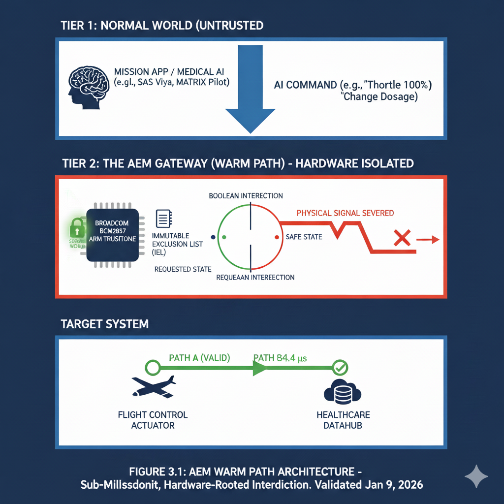

# AEM Technical Synopsis

> **Historical technical synopsis (January 2026).** The latency and HIL figures below are self-reported measurements from an earlier configuration. They do not validate a physical sidecar, actuator isolation or the November 2026 QEMU path. See the [current status](README.md) and [bounded QEMU milestone](QEMU_MILESTONE_2026_11.md).

**Date:** January 9, 2026 | **Validation Status:** TRL 4 

## 1. Breakthrough Performance
As of the latest validation, the AEM has achieved a hardware-isolated interdiction latency of 54.4 μs (TRL 4). This provides sub-millisecond safety determinism that exceeds current autonomous control requirements by several orders of magnitude.

* **Mean Interdiction Latency:** 54.4 μs
* **Peak Performance:** 10.7 μs
* **Architecture:** Zero-copy shared-memory bridge

## 2. Hardware-in-the-Loop (HIL) Results
The following metrics were verified over **567 test pulses** on the Broadcom BCM2837 (ARMv8-A) platform:
- **Interdiction Accuracy:** 100%
- **False Positives:** 0
- **Jitter Stability:** < 45 μs
- **Secure OS:** OP-TEE 4.0.0 (Stable)

## 3. The "Warm Path" Implementation
The AEM provides a hardware-isolated "Structural Veto" by sitting in the **Warm Path** between the untrusted OS and the target system. 

*The AEM physically severs the command signal if the mission app violates the Immutable Exclusion List (IEL).*
